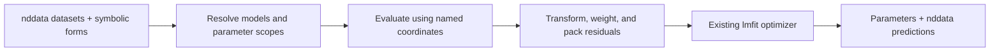

# Objective

Refactor `lmfitdata` into a container for one or more `nddata` objects,
rather than simply inheriting a single `nddata` object.
Fit across dimensions and datasets by evaluating symbolic expressions and
concatenating their residuals into one real vector.
Preserve existing single-dataset behavior and reuse the current symbolic
evaluation machinery.
The interfaces below are the implementation plan.

# Example of a target physical model

The global fit combines magnetization versus power, $M_\epsilon(p)$,
with FIR curves measured at recovery times $\tau_j$ and powers $p_k$.
(Currently, an FIR at each power is stored in a different dataset).
Use $T_1$ for the relaxation time; $R_1=1/T_1$ is its inverse.
The shared relaxation model is

$$
\begin{aligned}
T_{1,w}(p) &= T_{1,w}(0)+p\,\Delta T_{1,w}, \\
k_{\rho,\mathrm{inv}}(p)
&= \frac{C_{SL}}{R_1(p)-T_{1,w}(p)^{-1}} \\
&= k_{\rho,\mathrm{inv},a}
+ k_{\rho,\mathrm{inv},b}p+k_{\rho,\mathrm{inv},c}p^2, \\
R_1(p) &=
\frac{1}{T_{1,w}(p)}+\frac{C_{SL}}{k_{\rho,\mathrm{inv}}(p)}.
\end{aligned}
$$

Here $C_{SL}$ is the spin-label concentration.
It is a **constant** -- *i.e.* it is fixed for all datapoints of all datasets.
Fix $k_{\rho,\mathrm{inv},c}=0$ for the linear inverse-relaxivity model in
[fit_ODNP_data.py](../../proc_scripts/examples/broken/fit_ODNP_data.py);
allow $k_{\rho,\mathrm{inv},c}$ to vary for the quadratic extension.
$T_{1,w}(0)$ and $\Delta T_{1,w}$ may either be constants, or fit parameters,
depending on implementation.

$$
\begin{aligned}
s(p) &= \frac{s_{max} p}{p+p_{1/2}}, \\
M_\epsilon(p) &= M_\epsilon(0)\left[
1-\frac{C_{SL}k_\sigma s(p)
\left|\omega_e/\omega_H\right|}{R_1(p)}
\right].
\end{aligned}
$$

Because all the terms on the right hand side of
$A=C_{SL}k_\sigma|\omega_e/\omega_H| s_{max}$
except $k_\sigma$ are constants,
we can rewrite this as

$$
M_\epsilon(p_k) = M_\epsilon(0)\left[
1-\frac{A s_{normed}(p_k)}{R_1(p_k)}
\right].
$$

where $s_{normed}(p)=p/(p+p_{1/2})$ does not include $s_{max}$.
Fit $A$ directly as a global parameter.
After fitting, calculate $k_\sigma$ outside the fitting code:
$$
k_\sigma=\frac{A}{C_{SL}s_{max}|\omega_e/\omega_H|}.
$$
The user performs this conversion using the
fitted `A`; `k_sigma` is not
a fitting parameter or a symbol in `functional_forms`.

The FIR model from
[proc_FIR.py](../../proc_scripts/examples/proc_FIR.py) includes the finite
repetition delay:

$$
M_{\tau}(\tau_j,p_k)=M_{\tau,k}(\infty)
\left[1-\left(2-e^{-W_k R_1(p_k)}\right)e^{-\tau_j R_1(p_k)}\right].
$$

$$
W_k=10^{-6}\,\mathtt{FIR\_rep\_us}_k
+10^{-3}\,\mathtt{acq\_time\_ms}_k.
$$

Use seconds for $W_k$, $\tau$, and $T_1$.
Use inverse seconds for $R_1$.
The acquisition metadata stores `FIR_rep_us` (or legacy `FIR_rep`)
in microseconds and `acq_time_ms` in milliseconds.
The endpoint values $M_\epsilon(0)$ and $M_{\tau,k}(\infty)$
are scalar fitting parameters, represented below by `M_p0` and `M_inf_k`.
They also equal their expressions evaluated at $p=0$ and
$\tau\to\infty$, respectively.
Here $j$ indexes recovery times and $k$ indexes powers; the recovery
asymptote and $W_k$ belong to the experiment at power $p_k$.

Note that we typically write code for the equations above as given above,
to preserve legibility and ease the process of setting up global fitting.
We rely on the `lmfitdata` module to perform the substitution and identify the
types of parameters (more on this below).
After substitution, there are only two equations:
one for $M_{\tau}(\tau_j,p_k)$ that describes the FIR experiments,
and one for $M_\epsilon(p_k)$
that describes progressive saturation.

# Datasets and functional forms

Accept a dictionary of datasets or a dictionary-like HDF5 group directly.
For example, select already loaded experimental datasets:

```python
datasets = {
    "T1_0": loaded["T1_0"],
    "T1_1": loaded["T1_1"],
    "M_ε": loaded["M_ε"],
}
```

Select recovery experiments by name using a regular expression.
Assume the loader supplies each experiment's power in watts in a
`power_W` property.
Copy it to `p` to supply the coordinate linking the recovery datasets.

```python
import re

T1_names = [name for name in datasets if re.fullmatch(r"(?:T1|FIR)_.*", name)]

for name, dataset in datasets.items():
    dataset.name(name)

for name in T1_names:
    datasets[name].set_prop("p", datasets[name].get_prop("power_W"))
    acq = datasets[name].get_prop("acq_params")
    rep_us = acq["FIR_rep_us"] if "FIR_rep_us" in acq else acq["FIR_rep"]
    datasets[name].set_prop("W_k", rep_us * 1e-6 + acq["acq_time_ms"] * 1e-3)
```

The recovery datasets already have a `tau` axis; `datasets["M_ε"]` already
has a `p` axis.
The fit fixes the globalpar `C_SL`.
Fix `T_1w0` and `dT_1w` when known; otherwise vary them in the fit.
The saturation limit and frequency ratio are used only in the external
conversion from fitted `A` to $k_\sigma$.
Each recovery dataset's `p` property supplies a variable,
while its `W_k`
property fixes an indeplocalpar for that experiment.
Keep both as top-level properties set with `.set_prop()`.

Supply all datasets and expressions at construction.
Each dictionary key is the string representation of the symbol on the left
of an equality, and its value is the expression on the right.
Use expressions, never SymPy equality objects.

```python
functional_forms = {
    "M_τ": M_inf_k * (1 - (2 - exp(-W_k * R_1)) * exp(-tau * R_1)),
    "M_ε": M_p0 * (1 - A * s_normed / R_1),
    "R_1": 1 / T_1w + C_SL / k_rho_inv,
    "T_1w": T_1w0 + p * dT_1w,
    "k_rho_inv": k_rho_inv_a + k_rho_inv_b * p + k_rho_inv_c * p**2,
    "s_normed": p / (p + p_half),
}
fit = lmfitdata(datasets, functional_forms=functional_forms)
```

Fix parameters through the existing `lmfitdata.set_guess()` API:

```python
fit.set_guess(
    A=dict(value=A_guess),
    C_SL=dict(value=concentration_M, vary=False),
    k_rho_inv_c=dict(value=0.0, vary=False),
)
```

Use an initial guess `A_guess` and the experimental concentration.
Supply guesses for the remaining globalpars and expanded indeplocalpars in the
same call, fixing `T_1w0` and `dT_1w` there too when known.
Modify the existing [`set_guess()` method](../pyspecdata/lmfitdata.py)
to save the original functional forms and parameter records.
After classification, validation, index expansion, and dependent-expression
substitution, substitute fixed (*i.e.* with `vary=False`) globalpar and indeplocalpar values.
(This avoids subsequent complications when building Jacobians, etc.)
When a fixed value or `vary` changes, rebuild from the saved original forms,
restoring symbols for parameters that become variable again.

The fit shares `k_rho_inv_a`, `k_rho_inv_b`, `A`, `p_half`,
and `M_p0` across the container, with a separate `M_inf_k` for each recovery
dataset at power $p_k$.
Thus `C_SL` remains a globalpar when fixed or substituted out.
Likewise, `W_k` remains an indeplocalpar when fixed from metadata.
Fix `k_rho_inv_c=0` or fit it according to the chosen inverse-relaxivity model.
Optimize the shared relaxation parameters jointly from the recovery and
magnetization data.

# Vocabulary, classification, and validation

Use the following vocabulary consistently in the plan, implementation,
and `lmfitdata` class docstring so we can discuss the architecture precisely:

- **variables**: coordinates identified from dataset axis coordinate
  (*e.g.* the $\tau$ of an inversion recovery experiment)
  or with a variable that changes across the different nddata objects
  (*e.g.* the microwave power $p$ at which the inversion recovery experiment is
  conducted).
  Note that it can be both of these -- *e.g.* the same `lmfitdata` container
  might hold
  $M_\varepsilon(p)$ data (where $p$ is an axis coordinate) as well as
  $M_\tau(p,\tau)$ data
  (where it's a property).
  A variable is identified based on its match to name of an nddata axis
  coordinate label
  *or* by its match to the name of a symbol found in the functional forms
  that (1) matches a top-level property key present in all the nddata and
  (2) does not have a dataset-index
  suffix (`_i`, `_j`, `_k`, etc.) when given in the functional form
  and (3) does not match a *globalpar* (see below).
  Every axis coordinate label of every dataset must match a model variable;
  otherwise the model fails validation.
  Each variable used by a dataset's funcval must be available there as an
  axis coordinate or top-level property.
- **funcvals** (function values): symbols whose expressions calculate
  the values used in residuals, such as `M_ε` and `M_τ`.
  They are neither variables nor parameters.
- **parameters**: quantities that may be
  optimized, fixed, or computed;
  the overall goal of optimization is to
  adjust the parameters to choose the best
  physical model possible with the functional
  form that's given.
- **globalpars** (global parameters):
  parameters shared across the
  fitting container.
  These are the remaining model symbols after classifying variables,
  funcvals, deplocalpars, and indeplocalpars.
- localpars (local parameters): quantities local to one dataset,
  either optimized independently or computed by substitution.
- **deplocalpars** (dependent local parameters): quantities computed by
  substituting supplied
  expressions involving model variables or parameters.
  They are the functional-form dictionary keys referenced by other
  expressions, such as `R_1`.
  The expression for `R_1` is evaluated at each dataset's
  power `p_k`.
  They are dependent in the sense
  that they depend on other variables and/or
  parameters.
  Deplocalpars are only used for the user-side definitions.
  Internally, after classifying the variables,
  the code substitutes the expression for each deplocalpar.
  For example, the expression for `R_1`
  is substituted and evaluated using each dataset's
  power;
  the code doesn't create independently adjustable `R_1_0` or `R_1_1`.
  Their values are already determined by the shared relaxation model.
  From the perspective of the code,
  deplocalpars exist only to make the model human-readable.
  The model can,
  at the end of the day,
  be written as a function of *only* the variables,
  globalpars, and indeplocalpars.
- **indeplocalpars** (independent local parameters):
  parameters that vary with each dataset.
  As such, among the set of variables and
  parameters, they are independent.
  In order for a given model to pass
  validation,
  indeplocalpars must be named in a
  particular way:
  specifically, their name must end with an
  index letter, such as `_i`, `_j`, or `_k`.
  For example, `M_inf_k` is the value of the
  parameter we call $M_\infty$.
  The SymPy symbol with the name
  `M_inf_k` is only used in the definition above.
  Internally, it is replaced with a different variable for each dataset.
  Specifically,
  for each of datasets indexed by $k$ with
  power $p_k$,
  we create a separate parameter:
  for example `M_inf_0` at the first power, `M_inf_1` at the second,
  *etc.*
  A point of clarification:
  Fixing such a parameter from experimental metadata, as with `W_k`,
  does not make it dependent on other model variables or parameters;
  thus, *e.g.* `W_k` is still an indeplocalpar.

Classification uses the disjoint classes **variables**, **funcvals**,
**globalpars**, **deplocalpars**, and **indeplocalpars**.
`parameters` and `localpars` are umbrella terms for the corresponding classes.
Whether a parameter is fixed is separate from its classification.
The classification procedure and validation requirements are enumerated in
stop point 1.

# Container behavior and transforms

Preserve all delegated `nddata` attributes, methods, and properties for a
single dataset, including chaining such as `fit.ft("t").ift("t")`.
For multiple datasets, select a dataset explicitly:

```python
fit["M_ε"].getaxis("p")
fit["T1_0"].getaxis("tau")
```

Mapping keys must agree with the contained datasets' `nddata.name()` values.
For sequence input, derive keys from those names and require every dataset
to be named.
Both `fit.copy()` and `fit.C` deep-copy the container, including datasets,
symbolic state, parameters, and transforms.
Single-dataset `eval()` returns an `nddata`; multi-dataset `eval()` returns
a dictionary with the input dataset keys.

Keep the existing single-dataset transform decorators:

```python
@fit.define_residual_transform
def residual_domain_transform(d):
    return d.ft("t")
```

For multiple datasets, expose decorators through dataset selection:

```python
@fit["M_ε"].define_residual_transform
def magnetization_residual_transform(d):
    return d


@fit["T1_0"].define_data_transform
def recovery_data_transform(d):
    return d
```

Store transforms in container-level dictionaries keyed by dataset name.
Reuse or retool `lmfitdata` behavior to support dataset selection and
these decorators; do not introduce a separate `FitMember` class.

# Residual construction

For each dataset, evaluate its funcval's substituted expression with axis and
property variables using the existing compact multi-argument lambda
machinery, particularly `fitfunc_multiarg_v2`.
Reshape axis arrays to broadcast correctly for multiple dimensions,
including nonsquare arrays.
Apply the dataset's data and residual transforms according to the existing
convention, subtract the transformed data, and ravel the residual.
View complex residuals as real using the current convention.
Concatenate all datasets' residuals into one 1D real vector.

# Implementation stop points

## Stop point 1: container, docstring, classification, and validation

Implement the container, naming checks, deep copies, delegated chaining,
and decorator-preserving transform storage and access.
Add the vocabulary and architecture TODO notes to the class docstring.
Implement classification using sets of symbols and the vocabulary above:

1. Normalize the single-expression API to `{"z_data": expression}`.
   Perform classification on sets of names before index expansion.
   Let `D` be the dictionary keys and `R` the union
   of names in the expressions' `free_symbols` and parsed expression strings.
   Exclude function names and mathematical constants such as `exp` and `pi`.
   Let `S = D | R`.
   Reject distinct symbols with the same string representation.
2. Classify `F = D - R` as funcvals: their expressions are not substituted
   into other supplied expressions.
   Classify `D & R` as deplocalpars.
   Build their dependency graph and reject circular dependencies.
3. Collect axis names from every dataset and property names present in
   every dataset, excluding dataset-index
   suffixes from the property names.
   Intersect these names with `R - D` to obtain the variables set `V`.
   Validate that every axis label of every dataset is in `V`.
   Consider only property names in `S`; ignore unrelated metadata.
   A definition cannot also supply an axis symbol.
   For indexed symbols supplied by properties, such as `W_k`,
   record their dataset bindings as fixed indeplocalpars.
   A symbol supplied both by a definition and a property is ambiguous.
4. Among `R - D - V`, classify names with dataset-index suffixes as
   indeplocalpars, whether fixed by metadata or free to optimize.
   Classify all remaining names as
   globalpars by set subtraction:
   `G = S - (V | F | deplocalpars | indeplocalpars)`.
   A parameter remains global even if only one funcval uses it.
   If an indexed symbol is bound for some applicable datasets,
   require bindings for all of them rather than optimizing missing values.
5. Use the dependency graph to determine the substitution order for
   deplocalpars.
   Keep fixed parameter values separate from model definitions:
   use `set_guess()` with `value` and `vary=False` for globalpars.
   Use per-dataset metadata or `set_guess()` on expanded names for
   indeplocalpars.
   Fixing a parameter does not change its classification.
   Only varying globalpars and indeplocalpars enter the optimizer.
6. For each dataset, choose exactly one funcval whose variables and required
   fixed localpar bindings are available and whose expression depends on all
   dataset axes.
   Inspect dependencies before substitution, then expand dataset-index
   suffixes and construct the SymPy expressions for each dataset.
   Transfer metadata bindings to the expanded names and substitute
   dependent expressions.
7. Validate that every symbol in `S` has exactly one of the five classes.
   Their union must equal `S`, and pairwise intersections must be empty.
   Every axis label must match a variable, every funcval must be used,
   and every required variable or fixed-parameter binding must exist.
   Each dataset must have exactly one funcval.
   Failure to classify any symbol unambiguously fails model validation.
   Report the symbols, competing or missing classes, and affected datasets;
   do not fit an invalid model.
   Once validation succeeds, substitute fixed parameter values last and
   compile evaluators and Jacobians from the remaining variables and
   varying parameters.
   Preserve the original forms, classifications, and fixed values for
   rebuilding, output, and copies.

Add classification and validation unit tests at this stop point.
For the example, expect funcvals `{M_τ, M_ε}`, variables `{tau, p}`,
indeplocalpars `{M_inf_k, W_k}` (with `W_k` fixed), and deplocalpars
`{R_1, T_1w, k_rho_inv, s_normed}`.
The remaining coefficient and fixed-parameter symbols, including `A` and
`C_SL`, are globalpars.
Test fixed values, globalpars used by only one funcval, alternative index
letters, missing bindings, unmatched dataset axes, mixed axis/property
variables, conflicting classifications, ambiguous funcvals,
and circular dependencies.
Defer multi-dataset fitting tests to stop point 3.
Run existing relevant tests and repository lint checks, then stop for review.

## Stop point 2: single-dataset multidimensional fitting

Implement and test multidimensional evaluation and axis broadcasting.
Pack residuals into a real vector using the existing evaluator.
Preserve single-dataset behavior, including complex residuals.
Extend `set_guess()` with the final fixed-value substitution described above.
Generate analytic Jacobians from the resulting expressions.
Test fixing parameters, changing fixed values, and changing `vary` in both
directions while preserving the original forms.
Verify matching fits with analytic and numerical Jacobians,
including bounds.
Run relevant tests and lint checks, then stop for review.

## Stop point 3: multi-dataset fitting

Implement and test recursive substitution, classification and
validation, indeplocalpar renaming, dataset-specific decorators,
residual concatenation, dictionary `eval()` output, and the construction
summary showing each dataset's substituted expression.
Cover mapping input, top-level property variables, and errors for ambiguous
expressions or missing names.
Run relevant tests and lint checks, then stop for review.

## Stop point 4: synthetic ODNP test and plotted example

Fit noisy synthetic FIR recovery and magnetization-versus-power datasets
jointly to recover the globalpar `A` with the physical model above.
Then calculate `k_sigma` outside the fitting code using the conversion above.
Use known fixed globalpar values, positive relaxation times and inverse
relaxivity over the fitted power range, and the stated saturation convention.
Add a matching example plotting the data and fitted curves.
Run relevant tests and lint checks.

# Building the PDF

From the repository root:

```bash
source /home/jmfranck/base/bin/activate
export PATH="/usr/local/texlive/2024/bin/x86_64-linux:$PATH"
pandoc summaries/global_fitting_plan.md \
  --from=markdown --standalone --pdf-engine=pdflatex \
  --output=summaries/global_fitting_plan.pdf
```

Omit the `export` if `pdflatex` is already on `PATH`.

# AG Understanding, Elobaration, Example Working Script and Future Implementations

**Date: Oct 23, 2026**

**Oct 29, 2026 update:** John Franck's final implementation plan above is
authoritative. The October 23 discussion below is retained as historical
analysis; its earlier model, assignment suggestions, and open staging questions
do not override the final plan. The example script and final validation summary
have been revised on October 29 to match that plan.

This addition records the understanding, elaboration, research, and proposed
example discussed on October 23, 2026. It supplements the recovered plan above;
the possible rules, enhancements, and staging adjustments below are proposals,
not approved implementation changes. The example describes the intended API
after implementation and is not executable against the current container API.

## Review scope and baseline

The review covered the full plan, [AGENTS.md](../AGENTS.md), the
[current fitting implementation](../pyspecdata/lmfitdata.py), its
[Jacobian tests](../tests/test_lmfitdata_jacobian.py), the
[four fitting examples](../examples/fitting/), and the
[CI rules](../.github/workflows/).

**Assessment: this is a worthwhile extension with a sound numerical foundation.
The main risk is preserving the existing API while making model assignment,
weighting, and transforms unambiguous.** Those contracts should be refined
before implementing stop point 1.

No repository files were changed during the analysis. Using the shared local
environment at `/Users/atahan/.venv`, the following baseline was established:

- All **3 existing Jacobian tests pass**.
- All **4 fitting examples execute successfully** with a noninteractive
  plotting backend.
- A separate nonsquare 2D probe fails, even when `fit_axis` is supplied.
- A float32 residual probe also fails.

The example runs establish an execution baseline; they do not yet establish
numerical regression coverage. These results describe the October 23 review,
not a claim that the proposed architecture has been implemented.

## Purpose and advantages

The purpose is to **fit several related measurements together while expressing
their shared physics once**.

For example, the proposed recovery model is

$$
M_j(\tau)=M_{\infty,j}
 +(M_{0,j}-M_{\infty,j})
 e^{-\tau(R_{10}+k_\rho p_j)}.
$$

| Quantity | Meaning in the fitting architecture |
|---|---|
| $\tau$ | Coordinate supplied by a dataset axis |
| $p_j$ | Fixed experimental condition supplied by a dataset property |
| $R_{10},k_\rho$ | Shared fitted parameters |
| $M_{0,j},M_{\infty,j}$ | Independently fitted parameters for each recovery dataset |
| $R_1(p)$ | Derived expression, substituted into the models |

An enhancement dataset can use the same $R_1(p)$. The optimizer then sees
one combined residual:

$$
r(\theta)=
\begin{bmatrix}
r_{\mathrm{T1_0}}(\theta)\\
r_{\mathrm{T1_1}}(\theta)\\
r_{\mathrm{E}}(\theta)
\end{bmatrix}.
$$

For independent measurements with known standard deviations, the usual
weighted contribution is

$$
r_{j,k}=\frac{f_j(x_{j,k};\theta)-y_{j,k}}{\sigma_{j,k}}.
$$

“Global fitting” here means fitting datasets jointly. **It does not mean the
optimizer is guaranteed to find the global minimum.**

The main advantages are:

- **Information sharing.** A well-measured dataset can constrain parameters
  that another dataset determines poorly.
- **Consistent uncertainty estimation.** Joint fitting can account for
  correlations between shared parameters, rather than treating previously
  fitted quantities as exact inputs.
- **Less repeated analysis code.** Users would no longer manually expand
  local parameters and concatenate residuals.
- **Natural multidimensional fitting.** Named axes would identify independent
  variables, with broadcasting handled internally.
- **Preservation of spectroscopy metadata.** Models and predictions remain
  associated with `nddata` axes, units, properties, and transforms.
- **Inspectable equations.** Printing each substituted expression makes it
  possible to verify what the optimizer is actually fitting.

These benefits depend on the shared model being appropriate. Incorrectly
forcing two datasets to share a parameter can produce precise-looking but
biased results.

## Caveats and unresolved contracts

### Automatic model assignment

**Automatic model assignment needs a deterministic rule.** The recovered plan
already identifies this uncertainty. A T1 dataset has a `tau` axis and a scalar
`p` property, so both a model using `tau,p` and an enhancement model using only
`p` could appear compatible.

A possible rule is:

1. Resolve substitution dependencies first.
2. Reject models requiring known coordinate variables unavailable in that
   dataset.
3. Prefer the model explaining the greatest number of that dataset’s axes.
4. Raise an informative error if multiple candidates remain equally suitable.

**The fourth bullet can be a better solution than selecting a model by a
heuristic:** when more than one assignment is plausible, reporting the
ambiguity lets the user resolve the intended model explicitly. A stricter
alternative would reject any remaining ambiguity after availability checks,
rather than use the third bullet to choose a winner. This tradeoff remains
open for clarification; the heuristic is not an agreed requirement.

With the axis-coverage heuristic, the T1 model explains the `tau` axis; the
enhancement model does not. For two competing models that both depend on
`tau`, the library must report ambiguity.

An explicit assignment override could be useful later, but it would be an
**addition to the current plan**, which specifies automatic assignment.

### Parameter scope

**Parameter scope cannot be inferred from occurrence counts.** In the ODNP
example, `k_sigma` appears only in the enhancement model but is still a global
parameter. Therefore, “appears in one dataset” cannot mean “local.”

A simple, consistent convention would be:

- Axis/property symbols are variables.
- Equation left-hand symbols are dependent quantities.
- Remaining symbols ending in `_i` are independent local parameters.
- Other remaining symbols belong to the global parameter namespace.

The requirement to detect an independent local parameter *missing* `_i` is
under-specified: without another declaration, the sorter cannot know whether
`amplitude` was intended to be shared or local. That needs clarification.

### Weighting and statistical interpretation

**Weighting is a scientific correctness issue, not just an implementation
detail.** The current
[residual implementation](../pyspecdata/lmfitdata.py) uses

$$
r=\frac{f-y}{\sigma}
  \left(\sum_k\frac{1}{\sigma_k}\right).
$$

For one dataset, that extra constant does not change the ideal least-squares
minimizer. Applied separately to several datasets, however, it changes their
relative influence.

Standard uncertainty weighting is recommended for the new joint-fitting
path. Any change to legacy weighting should be separately approved and tested
because it affects reported statistics and potentially numerical convergence.

Likewise, dividing every dataset’s residual by $\sqrt{N_j}$ would give
datasets more equal influence, but that represents a different objective. It
should never happen silently.

### Transforms and derivatives

**Transforms and derivatives must describe the same residual.** The existing
implementation applies the residual transform to symbolic derivatives. This
works for a parameter-independent linear operation such as a Fourier
transform:

$$
\frac{\partial Tf}{\partial\theta}
=T\frac{\partial f}{\partial\theta}.
$$

It does not generally work for magnitude, clipping, or normalization by the
model maximum.

A possible initial policy would be:

- Support the current analytic derivative path for compatible linear
  transforms.
- Retain `fit(use_jacobian=False)` for arbitrary transforms.
- Document the restriction rather than attempting to infer whether a Python
  function is linear.

Transforming uncertainties also needs attention. Fourier transforms,
filtering, and resampling can change variances and introduce correlations.
Simply reusing the original pointwise errors is not universally correct.

### Backward compatibility

**Backward compatibility is broader than forwarding methods.** The current
class [inherits from `nddata`](../pyspecdata/lmfitdata.py), and
[plotting code](../pyspecdata/core.py) checks `isinstance(..., nddata)`.

Compatibility must cover:

- Arithmetic and slicing.
- Attribute assignment, including `.data`.
- Properties such as `.real`, `.imag`, and `.C`.
- Chaining such as `.ft(...).ift(...)`.
- Direct assignment to `.residual_transform`, used by an existing example.
- `copy(data=False)`, used internally.
- The single-dataset return type and transform behavior of `eval()`.
- Existing consumers such as
  [`lmfitdataGUI`](../pyspecdata/lmfitdataGUI.py).

A simple `__getattr__` wrapper cannot cover every case: Python looks up
implicitly invoked special methods differently.
[Python’s data-model documentation](https://docs.python.org/3.13/reference/datamodel.html#special-method-lookup)

There is also a subtler compatibility conflict: matching top-level properties
to symbols can turn a previously fitted parameter into a fixed variable. An
existing dataset might already contain a property named `R_1`. An explicit
policy for legacy construction is needed rather than assuming this change
is harmless.

### Other implementation risks

The remaining implementation risks are manageable, but deserve tests:

| Risk | Possible handling |
|---|---|
| Two datasets have the same name | Reject duplicates before constructing dictionaries |
| Dataset renamed after construction | Define stable keys or update all associated mappings atomically |
| Axis and property share a symbol name | Reject or specify precedence explicitly |
| Substitution equations depend on each other | Resolve dependencies in order; reject cycles and conflicting definitions |
| Generated names collide, such as an existing `M_0_0` | Detect collisions before constructing optimizer parameters |
| Different axis lengths | Broadcast by named dimension positions, not raw one-dimensional arrays |
| Constant model or derivative | Broadcast it to the dataset’s full shape |
| NaNs appear as parameters change | Keep a fixed observation mask; reject newly invalid model evaluations |
| Complex or float32 residuals | Convert to a suitable contiguous dtype before packing; use identical packing for derivatives |
| Data, properties, or transforms change | Invalidate or rebuild affected caches |
| Parameter is fixed with `vary=False` | Differentiate with respect to the optimizer’s free parameters only |

The fixed-mask point matters particularly: lmfit requires the residual length
to remain constant during optimization. Its documentation also distinguishes
missing observations from NaNs generated by invalid model evaluations.
[lmfit fitting requirements](https://lmfit.github.io/lmfit-py/fitting.html#writing-a-fitting-function),
[lmfit NaN guidance](https://lmfit.github.io/lmfit-py/faq.html#i-get-errors-from-nan-in-my-fit-what-can-i-do)

## Complexity and architecture

**The feature need not become bulky, but stop point 1 is more substantial than
“container scaffolding” suggests.**

The numerical implementation can remain compact:



A compact architecture would keep one optimizer parameter collection,
container-level dictionaries, and one consistent evaluation path shared by
`eval()`, residuals, and derivatives.

For selected datasets, a view implemented through the existing `lmfitdata`
class could hold a parent reference and dataset key. That respects the plan’s
prohibition on a separate `FitMember` class. It should refer to the parent’s
state rather than maintain a second independent fitting state.

Complexity would grow unnecessarily if the implementation added a general
modeling language, multiple optimizer frameworks, a plugin architecture, or
automatic inference of arbitrary transform behavior.

There is also a scaling limit: with $N$ residual entries and $P$ fitted
parameters, a dense Jacobian requires storage proportional to $NP$. For the
intended ODNP example, that is modest. Hundreds of datasets with many local
parameters may eventually justify sparse derivatives.

## Related implementations and research references

The following comparable implementations provide useful references. The
application recommendations are an assessment of how their documented
approaches could improve this implementation, rather than claims that these
libraries eliminate every corresponding failure mode.

| Reference | Documented approach | Potential application |
|---|---|---|
| [lmfit multiple-dataset example](https://lmfit.github.io/lmfit-py/examples/example_fit_multi_datasets.html) | Builds one flattened residual and ties shared parameters | Keep residual assembly simple and reuse lmfit |
| [lmfit mathematical constraints](https://lmfit.github.io/lmfit-py/constraints.html) | Derives scalar parameters from other parameters | Reuse its parameter bounds and fixed-value machinery; avoid inventing another constraint engine |
| [symfit multidataset fitting](https://symfit.readthedocs.io/en/stable/fitting_types.html#fitting-multiple-datasets) | Symbolic model components share parameter objects and may use different coordinate arrays | Maintain explicit internal dataset/model associations; do not require identical grids |
| [symfit model internals](https://symfit.readthedocs.io/en/stable/module_docs.html#symfit.core.models.BaseCallableModel) | Uses dependency mappings and ordered evaluation | Resolve dependent equations deterministically and preserve derivative dependencies |
| [Mantid MultiDomainFunction](https://docs.mantidproject.org/nightly/fitting/fitfunctions/MultiDomainFunction.html) | Explicitly associates functions with domains and qualifies parameter names | Make the automatic assignment result inspectable and keep a clear local-parameter mapping |
| [SciPy `least_squares`](https://docs.scipy.org/doc/scipy/reference/generated/scipy.optimize.least_squares.html) | Supports robust losses, parameter scaling, and sparse Jacobians | Expose selected solver options later through lmfit instead of implementing them internally |
| [pyglotaran](https://pyglotaran.readthedocs.io/en/latest/notebooks/getting_started/getting_started.html) | Provides model validation and separates nonlinear from conditionally linear parameters | Add useful preflight diagnostics now; consider variable projection later |

One important distinction: lmfit parameter expressions are useful for scalar
parameter relationships. The proposed `R_1(p)` varies along the enhancement
dataset’s power axis, so **symbolic substitution into the model is the
appropriate representation**; it should not become one scalar lmfit
parameter.

## Possible enhancements and future implementations

The following enhancements are candidates for prioritization:

| Enhancement | Benefit | Relative scope |
|---|---|---|
| Reusable model summary | Users can inspect assignments and expanded equations after construction | Small |
| Preflight validation | Reports missing coordinates, invalid errors, ambiguous forms, and name collisions before optimization | Small–moderate |
| Per-dataset residual diagnostics | Shows which dataset contributes most to the objective | Small once residual blocks exist |
| Unknown-guess-name errors | Catches misspelled parameter names currently easy to overlook | Small, with compatibility tests |
| Deterministic parameter ordering | Makes reports, copying, and regression tests reproducible | Small |
| Numerical derivative cross-check | Detects mismatches involving substitutions, transforms, weighting, and packing | Moderate, mostly testing |
| Expose `scale_covar` and selected solver options | Makes uncertainty conventions and robust fitting accessible | Moderate |
| Derived-quantity uncertainty | Provides uncertainty on quantities such as $R_1(p)$ using parameter covariance | Moderate |

For diagnostics, an initial implementation could report each dataset’s
residual count, RMS residual, and weighted sum of squares. A per-dataset
“reduced chi-square” should not be presented without defining how shared
parameters contribute to its degrees of freedom.

For symbolic performance, SymPy already offers common-subexpression
elimination and control over expensive generated docstrings. These are worth
benchmarking before building custom optimizations.
[SymPy `lambdify` documentation](https://docs.sympy.org/latest/modules/utilities/lambdify.html)

**Variable projection is a promising later improvement, rather than a quick
addition.** Once relaxation rates are fixed, recovery amplitudes are linear
parameters. Solving those linear coefficients inside each nonlinear iteration
could reduce the nonlinear search substantially. pyglotaran exposes this
separation directly. Bounds, covariance, and transforms make a correct
implementation more involved.
[pyglotaran variable-projection API](https://pyglotaran.readthedocs.io/en/stable/api/glotaran/optimization/variable_projection/glotaran.optimization.variable_projection.residual_variable_projection.html)

## Example working script for the intended API

**Updated: Oct 29, 2026.** This example follows John Franck's final plan in
[commit `8d5e3a81`](https://github.com/jmfrancklab/pyspecdata/commit/8d5e3a810486e7588926708710f97bd4d6702f06),
as incorporated in
[`2f454ccc`](https://github.com/jmfrancklab/pyspecdata/commit/2f454ccca0d8d647fbb67cfd2fe3618b56ccfdfe).
It replaces the earlier linear-rate demonstration. The container API remains
an implementation target; this is not a claim that the complete script runs
against the current `lmfitdata` implementation.

The example generates four finite-repetition FIR experiments and one
magnetization-versus-power experiment. All five use the same relaxation law:

$$
T_{1,w}(p)=T_{1,w}(0)+p\Delta T_{1,w},\qquad
k_{\rho,\mathrm{inv}}(p)=a+bp+cp^2,\qquad
R_1(p)=\frac{1}{T_{1,w}(p)}+
\frac{C_{SL}}{k_{\rho,\mathrm{inv}}(p)}.
$$

Here $a$, $b$, and $c$ correspond to `k_rho_inv_a`, `k_rho_inv_b`, and
`k_rho_inv_c`. Their units are molar seconds, molar seconds per watt, and
molar seconds per watt squared. This demonstration fixes $c=0$, the known
concentration, and the known water-relaxation coefficients. It fits the
remaining shared coefficients and one recovery asymptote per FIR dataset.

The two funcvals are

$$
M_\tau(\tau,p)=M_{\infty,k}
\left[1-\left(2-e^{-W_kR_1(p)}\right)e^{-\tau R_1(p)}\right],
\qquad
M_\epsilon(p)=M_{p0}\left[1-\frac{A}{R_1(p)}
\frac{p}{p+p_{1/2}}\right].
$$

Fit `A`, not `k_sigma`. The saturation limit and frequency ratio are known
inputs used outside the fitting model:

$$
k_\sigma=\frac{A}{C_{SL}s_{max}|\omega_e/\omega_H|}.
$$

The physical conventions follow the authoritative model above and the
referenced
[FIR processing script](../../proc_scripts/examples/proc_FIR.py),
[original ODNP example](../../proc_scripts/examples/broken/fit_ODNP_data.py),
and [current ODNP example](../../proc_scripts/examples/fit_ODNP_data.py).
For scientific background, see
[Franck et al., quantitative ODNP analysis](https://pmc.ncbi.nlm.nih.gov/articles/PMC3798041/).
These scripts provide context; the final plan governs the new API.

```python
import re

import matplotlib.pyplot as plt
import numpy as np
import sympy as sp
import pyspecdata as psd


def main():
    """Demonstrate the planned joint FIR/magnetization fitting interface."""
    rng = np.random.default_rng(20261029)

    # Known constants: concentration in M, water T1 in s, slope in s/W.
    concentration_M = 0.0002
    water_t1_zero = 2.5
    water_t1_slope = 0.15
    saturation_limit = 1.0
    frequency_ratio = 658.0  # Magnitude of omega_e / omega_H.
    true_k_sigma = 20.0  # M^-1 s^-1; not a fitting-model symbol.
    noise_sd = 0.01  # Signal standard deviation in arbitrary units.

    # A has units s^-1. The synthetic inverse-relaxivity model is linear.
    truth = {
        "A": concentration_M * saturation_limit * frequency_ratio
        * true_k_sigma,
        "k_rho_inv_a": 4.0e-4,
        "k_rho_inv_b": 4.0e-5,
        "p_half": 0.5,
        "M_p0": 1.2,
    }
    delays = np.linspace(0.0, 5.0, 101)  # Recovery times in seconds.
    powers = np.linspace(0.0, 3.0, 101)  # Microwave powers in watts.
    datasets = {}  # Insertion order defines this example's dataset indices.

    for index, (power, asymptote) in enumerate(
        [(0.0, 1.0), (0.5, 1.05), (1.5, 0.95), (3.0, 1.1)]
    ):
        # Simulate the same metadata fields supplied by an experiment loader.
        acquisition = {
            "FIR_rep_us": 800000.0 + index * 100000.0,
            "acq_time_ms": 100.0,
        }
        wait_seconds = (
            acquisition["FIR_rep_us"] * 1e-6
            + acquisition["acq_time_ms"] * 1e-3
        )
        relaxation_rate = (
            1.0 / (water_t1_zero + power * water_t1_slope)
            + concentration_M
            / (truth["k_rho_inv_a"] + truth["k_rho_inv_b"] * power)
        )

        # Include incomplete recovery during the finite repetition delay.
        recovery = asymptote * (
            1.0
            - (2.0 - np.exp(-wait_seconds * relaxation_rate))
            * np.exp(-delays * relaxation_rate)
        )
        recovery += rng.normal(0.0, noise_sd, delays.size)
        dataset = psd.nddata(recovery, "tau")
        dataset.setaxis("tau", delays).set_units("tau", "s")
        dataset.set_prop("power_W", power)
        dataset.set_prop("acq_params", acquisition)
        dataset.set_error(noise_sd)
        datasets[f"T1_{index}"] = dataset

    # Generate magnetization, retaining a fitted zero-power scale M_p0.
    relaxation_rate = (
        1.0 / (water_t1_zero + powers * water_t1_slope)
        + concentration_M
        / (truth["k_rho_inv_a"] + truth["k_rho_inv_b"] * powers)
    )
    magnetization = truth["M_p0"] * (
        1.0
        - truth["A"] * powers / (powers + truth["p_half"])
        / relaxation_rate
    )
    magnetization += rng.normal(0.0, noise_sd, powers.size)
    datasets["M_ε"] = (
        psd.nddata(magnetization, "p")
        .setaxis("p", powers)
        .set_units("p", "W")
        .set_error(noise_sd)
    )

    # Mapping keys must agree with nddata.name(); do this before construction.
    for name, dataset in datasets.items():
        dataset.name(name)

    # This same preparation applies to datasets supplied by a real loader.
    recovery_names = [
        name for name in datasets if re.fullmatch(r"(?:T1|FIR)_.*", name)
    ]
    for name in recovery_names:
        dataset = datasets[name]
        dataset.set_prop("p", dataset.get_prop("power_W"))
        acquisition = dataset.get_prop("acq_params")
        repetition_us = (
            acquisition["FIR_rep_us"]
            if "FIR_rep_us" in acquisition
            else acquisition["FIR_rep"]
        )
        dataset.set_prop(
            "W_k", repetition_us * 1e-6
            + acquisition["acq_time_ms"] * 1e-3,
        )

    # Variables: tau is an axis; p is an axis or a top-level property.
    tau, p = sp.symbols("tau p", real=True)

    # Dependent local parameters are readable intermediate definitions.
    R_1, T_1w, k_rho_inv, s_normed = sp.symbols(
        "R_1 T_1w k_rho_inv s_normed", real=True
    )

    # Global parameters retain their classification even when fixed.
    A, C_SL, T_1w0, dT_1w, M_p0, p_half = sp.symbols(
        "A C_SL T_1w0 dT_1w M_p0 p_half", real=True
    )
    k_rho_inv_a, k_rho_inv_b, k_rho_inv_c = sp.symbols(
        "k_rho_inv_a k_rho_inv_b k_rho_inv_c", real=True
    )

    # Indexed independent local parameters: M_inf_k varies; W_k is fixed.
    M_inf_k, W_k = sp.symbols("M_inf_k W_k", real=True)
    functional_forms = {
        "M_τ": M_inf_k * (
            1 - (2 - sp.exp(-W_k * R_1)) * sp.exp(-tau * R_1)
        ),
        "M_ε": M_p0 * (1 - A * s_normed / R_1),
        "R_1": 1 / T_1w + C_SL / k_rho_inv,
        "T_1w": T_1w0 + p * dT_1w,
        "k_rho_inv": (
            k_rho_inv_a + k_rho_inv_b * p + k_rho_inv_c * p**2
        ),
        "s_normed": p / (p + p_half),
    }

    # Keys name left-hand symbols; values are expressions, never sp.Eq.
    # The library assigns funcvals and substitutes intermediate definitions.
    fit = psd.lmfitdata(datasets, functional_forms=functional_forms)

    # All guesses and fixed global values are supplied in one set_guess call.
    guesses = {
        "A": dict(value=2.0, min=0.0, max=10.0),
        "C_SL": dict(value=concentration_M, vary=False),
        "T_1w0": dict(value=water_t1_zero, vary=False),
        "dT_1w": dict(value=water_t1_slope, vary=False),
        "k_rho_inv_a": dict(value=3.5e-4, min=1e-5, max=2e-3),
        "k_rho_inv_b": dict(value=5e-5, min=0.0, max=2e-4),
        "k_rho_inv_c": dict(value=0.0, vary=False),
        "p_half": dict(value=0.7, min=0.05, max=3.0),
        "M_p0": dict(value=1.1, min=0.1, max=2.0),
    }
    for index, name in enumerate(recovery_names):
        # The four recovery datasets precede M_ε in this mapping.
        guesses[f"M_inf_{index}"] = dict(value=1.0, min=0.1, max=2.0)

    # W_k values are already fixed by metadata; do not duplicate them here.
    # Fixed values are substituted last, leaving nine varying parameters.
    fit.set_guess(guesses)

    # C copies datasets, original forms, parameter records, and transforms.
    # set_to_guess evaluates initial values; eval returns a keyed dictionary.
    guess_curves = fit.C.set_to_guess().eval()
    fit.fit()  # Joint fit with the analytic Jacobian of the reduced model.
    fitted_curves = fit.eval()

    # Convert A to k_sigma outside the model; no k_sigma symbol is fitted.
    fitted_k_sigma = fit.output("A") / (
        concentration_M * saturation_limit * frequency_ratio
    )
    print(fit.fit_report())
    print("Fitted A / s^-1:", fit.output("A"))
    print("Derived k_sigma / (M^-1 s^-1):", fitted_k_sigma)
    print("Synthetic k_sigma / (M^-1 s^-1):", true_k_sigma)

    # Predicted curves remain nddata objects, including axes and metadata.
    figure, axes = plt.subplots(2, 3, figsize=(14, 8))
    for axis, (name, measured) in zip(axes.flat, datasets.items()):
        coordinate = measured.dimlabels[0]
        axis.errorbar(
            measured.getaxis(coordinate), measured.data,
            yerr=measured.get_error(), fmt=".", alpha=0.6,
            label="synthetic data",
        )
        psd.plot(guess_curves[name], "--", ax=axis, label="initial guess")
        psd.plot(fitted_curves[name], ax=axis, label="joint fit")
        axis.set_title(name)
        axis.set_xlabel(f"{coordinate} / {measured.get_units(coordinate)}")
        axis.set_ylabel("magnetization / a.u.")
        axis.legend()
    axes.flat[-1].set_visible(False)
    figure.tight_layout()
    plt.show()


if __name__ == "__main__":
    main()
```

### How this example follows the final plan

- **Mapping input:** four named recovery datasets and `M_ε` are passed as one
  dictionary. Mapping keys and `nddata.name()` agree.
- **Expression definitions:** dictionary keys name left-hand symbols and
  values are right-hand expressions. There are no `Eq` objects.
- **Funcvals:** `M_τ` and `M_ε` are the unreferenced dictionary keys. The
  recovery datasets use `M_τ`; the power sweep uses `M_ε`.
- **Variables:** `tau` and `p`. Recovery datasets supply `p` as metadata;
  the magnetization dataset supplies it as an axis. A compatible funcval
  must depend on every axis of its assigned dataset. There is no ranking
  heuristic: zero or multiple valid assignments fail validation.
- **Deplocalpars:** `R_1`, `T_1w`, `k_rho_inv`, and `s_normed` are recursively
  substituted in dependency order. They are not independently fitted.
- **Indeplocalpars:** `M_inf_k` expands to four free asymptotes, and `W_k`
  expands to four fixed values from metadata. A fixed local parameter is
  still an indeplocalpar, not a deplocalpar.
- **Globalpars:** `A`, `C_SL`, `T_1w0`, `dT_1w`, `k_rho_inv_a`,
  `k_rho_inv_b`, `k_rho_inv_c`, `p_half`, and `M_p0`. Five vary here; four
  are fixed. Parameters used by only one funcval remain globalpars.
- **Fixed-value substitution:** after validation, local index expansion, and
  dependent substitution, fixed values are substituted last. Analytic
  Jacobians therefore contain only the varying parameters. Original forms
  and parameter records must be retained so changing a fixed value or `vary`
  rebuilds the model correctly.
- **External conversion:** `A` is the fitted quantity. `k_sigma` is calculated
  afterward using known concentration, saturation limit, and frequency ratio.
- **Physical domain:** positive water-relaxation constants, positive
  `k_rho_inv_a`, nonnegative `k_rho_inv_b`, and fixed `k_rho_inv_c=0`
  keep relaxation times and inverse relaxivity positive over this nonnegative
  power range. A quadratic model requires checking positivity over the entire
  range, not merely changing `vary` on its coefficient.
- **Weighting:** all datasets have 101 samples and identical errors, so the
  example does not introduce a relative-weighting difference from separate
  legacy normalization factors. It does not establish an uncertainty policy
  for arbitrary datasets or transformed noise.

The earlier numerical reference table applied to the superseded linear-rate
example and is replaced by the following October 29 check. The revised
script's data and parameter setup was executed with current `nddata` objects.
An independent lmfit reference then fitted 505 residual entries with nine
varying parameters. Direct numerical equations agreed with recursively
substituted symbolic expressions, and analytic and numerical Jacobian fits
agreed within the checked tolerances.

| Quantity | Synthetic truth | Independent reference fit |
|---|---:|---:|
| `A` | 2.632 | 2.64737 |
| `k_rho_inv_a` | 0.0004 | 0.000399025 |
| `k_rho_inv_b` | 0.00004 | 0.0000397825 |
| `p_half` | 0.5 | 0.502633 |
| `M_p0` | 1.2 | 1.19514 |
| Derived `k_sigma` | 20.0 | 20.1168 |

These are results for one seeded synthetic noise realization, not guaranteed
accuracy for experimental data. They validate the example's numerical setup,
not execution of the future container API. End-to-end container acceptance
and plot inspection belong to stop point 4.

## Implementation stop points and validation

**Updated: Oct 29, 2026.** The authoritative stop points above now explicitly
require classification and validation tests at stop point 1. The earlier
October 23 staging question is resolved.

| Stop point | Required work and validation |
|---|---|
| **1 — Container, classification, and validation** | Naming, delegation, chaining, deep copies, decorator storage, five disjoint symbol classes, dependency cycles, unique funcval assignment, fixed metadata bindings, and classification/validation unit tests; preserve existing single-dataset tests |
| **2 — Single-dataset multidimensional fitting** | Named-axis broadcasting, nonsquare arrays, real/complex residuals, final fixed-value substitution in `set_guess()`, rebuilding after fixed-value or `vary` changes, and agreement between analytic and numerical Jacobian fits including bounds |
| **3 — Multiple datasets** | Mapping input, recursive substitution, index expansion, mixed axis/property variables, dataset decorators, concatenated residuals, dictionary predictions, construction summaries, and missing/ambiguous-input errors |
| **4 — Synthetic ODNP demonstration** | Fit noisy FIR and magnetization data with the final physical model, recover `A`, convert externally to `k_sigma`, enforce the physical domain, and inspect the matching plotted example |

At every approved stop point, run relevant tests and repository lint checks,
then stop for review as required by the plan. Local validation uses
`/Users/atahan/.venv` without reinstalling the editable checkout. Each
implementation step, merge, and commit remains subject to the separate
approval requirements in [AGENTS.md](../AGENTS.md).
