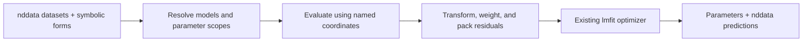

# Conversation source

This document recovers the final plan from the VS Code Codex conversation
**Sketch global fitting architecture**. The conversation began on
July 9, 2026 at 11:47 p.m. America/New_York and continued through July 14.
The final plan was recorded on July 14, 2026 at 1:24 p.m. America/New_York
(17:24:22 UTC).

Session identifier:

```text
019f4a22-fd3c-7e51-81be-1d47db0d8e00
```

The source is a local JSONL file in
`/home/jmfranck/.codex/sessions/2026/07/09/`, named:

```text
rollout-2026-07-09T23-47-14-
019f4a22-fd3c-7e51-81be-1d47db0d8e00.jsonl
```

The two lines above form one filename without a newline.

The final plan is lightly edited for standalone use. It incorporates the
last corrections about decorator transforms and top-level dataset properties.
Earlier requirements about method chaining, supplying datasets and equations
at construction, and fitting across both dimensions and datasets are made
explicit. Two wording slips in the final assistant summary are corrected:
`.C` means a deep copy, and dependent local parameters are computed quantities,
rather than independently optimized parameters. These corrections follow your
instructions in the conversation; the current `nddata.C` implementation also
returns `self.copy()`.

The document was rechecked against all seven proposed-plan revisions and your
successive corrections on October 7, 2026. The governing revision is the final
July 14 plan. Earlier requirements are retained where later corrections did
not supersede them, including implementing the sorter at stop point 1 and
showing each dataset's substituted expression.

This is a recovered design plan, not a claim that the proposed API has been
implemented. The Python snippets illustrate the proposed interfaces.

# Summary

Refactor `lmfitdata` into a container that can hold one or more `nddata` objects while preserving current single-dataset behavior. The architecture should support fitting across dimensions and/or across datasets by evaluating symbolic functional forms, raveling every modeled/data residual into one 1D real vector, and optimizing global plus local parameters.

Current single-dataset examples must continue to behave the same. Global fitting intentionally spans both multiple dimensions of one dataset and multiple datasets; the container provides the common abstraction. Multi-dataset behavior is added in staged stop points and reviewed before being broadly tested.

Refactor conservatively from the existing architecture, drawing on the older
branch history and comments while reusing the current symbolic evaluation
machinery.

# Public API and compatibility

- With one dataset, existing usage remains valid:

  ```python
  fit.ft(...)
  fit.getaxis("t")
  fit.C
  fit.copy()
  ```

- With multiple datasets, direct delegated `nddata` behavior is ambiguous and must use dictionary-like dataset selection:

  ```python
  fit["E(p)"].ft(...)
  fit["T1_0"].getaxis("tau")
  ```

- Delegation covers all `nddata` attributes, methods, and properties. Mutating
  methods that return the contained dataset must preserve container chaining,
  such as `fit.ft("t").ift("t")`.

- Dataset keys come from each contained `nddata.name()`. If more than one dataset is supplied, every dataset must already have a name.

- `.copy()` and `.C` are container operations, not delegated dataset operations.
  - `fit.copy()` deep-copies the whole fitting container.
  - `fit.C` returns a deep-copied fitting container, preserving symbolic state, parameters, transforms, and contained datasets.

- Single-dataset `eval()` returns an `nddata`, as now.
- Multi-dataset `eval()` returns a dictionary:

  ```python
  {
      "T1_0": fitted_T1_0,
      "T1_1": fitted_T1_1,
      "E(p)": fitted_E,
  }
  ```

# Nomenclature to add to the `lmfitdata` class docstring

The `lmfitdata` class docstring should define the core vocabulary up front:

- `variables`: symbols defining model coördinates/abscissae. They are not altered by optimization. They come from dataset axis labels or top-level dataset properties whose names match symbols in the functional forms. Axis variables determine the dimensions of the model array that is raveled into the residual vector; a top-level scalar property fixes a variable for that dataset.
- `parameters`: symbols altered by the optimizer.
- `globalpars`: short for “global parameters”; optimized parameters shared across the whole fit.
- `localpars`: quantities local to one dataset, either optimized independently or generated by substitution; document that `localpars` means “local parameters.”
- `dependent localpars`: local quantities generated by symbolic substitution. Example: `R_1` is not expanded to `R_1_i`; instead, every occurrence of `R_1` is replaced by something like `R_10 + k_rho*p`.
- `independent localpars`: per-dataset optimized parameters written with trailing `_i`, e.g. `M_0_i`, `M_inf_i`, then renamed to dataset-specific symbols such as `M_0_0`, `M_0_1`, etc.

If the sorter determines that a symbol is an independent localpar but it lacks trailing `_i`, raise an error.

# Variables and dataset metadata

Variables are discovered from:

- axis labels:

  ```python
  dE.setaxis("p", p_axis)
  ```

- top-level properties whose names match symbols:

  ```python
  dT1_0.set_prop("p", p0)
  dT1_1.set_prop("p", p1)
  ```

Do not use nested props like:

```python
set_prop("variables", {"p": p0})
```

For each dataset, the sorter should treat a symbol as a variable if it matches either a dataset axis label or a top-level property key.

# Functional forms

Functional forms are supplied as a dictionary. All datasets and relevant equations must be supplied when creating a multi-dataset container.

Existing single-expression API is preserved by internally normalizing to:

```python
functional_forms = {"z_data": expression}
```

New multi-form API:

```python
fit = lmfitdata(
    [dT1_0, dT1_1, dE],
    functional_forms={
        "T1": T1_recovery_form,
        "E(p)": E_of_p_form,
        "R_1": sympy.Eq(R_1, R1_of_p_form),
    },
)
```

The dictionary keys label the functional forms. They do not manually assign forms to datasets. Dataset-to-form assignment is still auto-determined by matching variables in the symbolic expression against variables available from each dataset’s axes and top-level props.

The sorter should:

- normalize old `.functional_form = expr` / single-expression construction to `{"z_data": expr}`;
- separate data-model expressions from substitution equations such as `Eq(R_1, R_10 + k_rho*p)`;
- assign each dataset exactly one data-model expression by variable matching;
- substitute dependent expressions directly;
- expand independent localpars ending in `_i`;
- classify symbols as variables, globalpars, dependent localpars, or independent localpars.

For multi-dataset construction only, print a stdout summary showing:

- each dataset and its variables;
- which functional form was assigned to each dataset;
- the post-substitution/post-renaming expression used for each residual;
- all variables, globalpars, dependent localpars, and independent localpars.

# Per-dataset transforms

Transforms must remain decorator-friendly.

Single-dataset behavior stays as now:

```python
@fit.define_residual_transform
def residual_domain_transform(d):
    return d.ft("t")
```

For multi-dataset fits, transforms are specified through dictionary-like dataset access:

```python
@fit["E(p)"].define_residual_transform
def E_residual_transform(d):
    return d


@fit["T1_0"].define_data_transform
def T1_0_data_transform(d):
    return d
```

Implementation should store these in container-level dictionaries keyed by dataset name, while exposing the decorator API through the selected dataset view. This should be done by reusing/retooling `lmfitdata` behavior, not by introducing a separate `FitMember` class.

Residual construction applies each dataset’s own data/residual transform before raveling and concatenating.

# Residual construction

All fits produce one 1D real residual vector.

For each dataset:

- evaluate its assigned symbolic model using the existing compact multi-argument lambda machinery, especially the current `fitfunc_multiarg_v2` pattern;
- use axis variables and top-level prop variables as the fixed variable inputs;
- apply that dataset’s data/residual transforms;
- subtract transformed data;
- ravel;
- view complex residuals as real, following the current convention.

For multi-dataset fits, concatenate the per-dataset residual vectors.

# ODNP target behavior

Example dataset setup:

```python
dT1_0.name("T1_0")
dT1_0.set_prop("p", p0)

dT1_1.name("T1_1")
dT1_1.set_prop("p", p1)

dE.name("E(p)")
# dE has p as an axis
```

Functional forms:

```python
T1_model = M_inf_i + (M_0_i - M_inf_i) * exp(-tau * R_1)

R1_model = Eq(R_1, R_10 + k_rho * p)

E_model = expression_involving(p, R_1, k_sigma, ...)
```

During construction:

- T1 datasets use `tau` from their axis and scalar `p` from top-level `.set_prop("p", p_i)`.
- `R_1` is substituted with `R_10 + k_rho*p`; no `R_1_i` symbols are created.
- `M_0_i` and `M_inf_i` become independent localpars per T1 dataset.
- `E(p)` uses its `p` axis and the same substituted `R_1(p)`.
- `k_sigma` is a globalpar.
- The residual concatenates all T1 residuals plus the enhancement residual.

The actual T1 expressions after substitution and renaming are:

```python
# T1_0: tau from its axis; p fixed to p0 from its top-level property
T1_0_form = M_inf_0 + (M_0_0 - M_inf_0) * exp(-tau * (R_10 + k_rho * p))

# T1_1: tau from its axis; p fixed to p1 from its top-level property
T1_1_form = M_inf_1 + (M_0_1 - M_inf_1) * exp(-tau * (R_10 + k_rho * p))

# E(p): p from its axis; substitute into the supplied enhancement form
E_assigned_form = E_of_p_form.subs(R_1, R_10 + k_rho * p)
```

Here `M_0_0`, `M_inf_0`, `M_0_1`, and `M_inf_1` are independently optimized
local parameters. `R_10` and `k_rho` are shared coefficients, and `k_sigma`
is a global parameter in the enhancement form. `R_1` is eliminated by
substitution; no numbered `R_1_i` symbols are introduced. These are expanded
illustrations of the proposed equations, not a new enhancement law.

# Stop points

## Stop point 1: container scaffold, docstring, sorting routine

Implement:

- internal container structure;
- exact preservation of single-dataset behavior;
- container-level `.copy()` and `.C`;
- decorator-preserving per-dataset transform storage/access;
- multi-dataset naming checks;
- `functional_forms` dictionary normalization, including old API to `{"z_data": expression}`;
- the variable/globalpar/localpar sorting routine;
- class docstring nomenclature and architecture TODO notes.

This stage includes code that supports multiple datasets in principle,
particularly the symbol-sorting routine; it is not limited to an empty
placeholder. Explicitly defer testing multi-dataset behavior to stop point 3.
Run existing relevant tests/lint and stop for review.

## Stop point 2: single-dataset multi-D fitting

Implement tested 2D/multi-D symbolic fitting for one dataset.

All model/data residuals should be raveled into one 1D real vector, and complex data should still use the current real-view convention. Reuse the existing compact lambda/evaluator path as much as possible.

Run tests/lint and stop for review.

## Stop point 3: tested multi-dataset fitting

Implement and test:

- functional-form dictionary assignment;
- dependent substitution such as `R_1 -> R_10 + k_rho*p`;
- independent localpar `_i` expansion;
- top-level prop variables via `.set_prop("p", p_value)`;
- per-dataset decorator transforms;
- residual concatenation;
- multi-dataset `eval()` dictionary output;
- stdout construction summary.

Run tests/lint and stop for review.

## Stop point 4: synthetic ODNP test and plotted example

Add:

- a noisy synthetic ODNP test fitting T1/R1 and `E(p)` together to recover `k_sigma`;
- a matching example that plots synthetic data and fitted curves.

This becomes the end-to-end demonstration of the intended global fitting architecture.

# Historical context and recovery commentary

The July 10 investigation reported no working general 2D fitting implementation
in the code paths and branches it inspected. Its nonsquare 2D probe failed when
raw axis arrays of different lengths reached `fitfunc_multiarg_v2` without
reshaping for broadcasting. Stop point 2 therefore includes correct axis
broadcasting as well as residual packing. This is a historical finding from
the conversation, not a fresh audit of today's repository.

The following implementation questions are recovery commentary added on
October 7, rather than additional requirements agreed in the July conversation.
They identify details that the final plan does not specify completely:

- **Automatic form matching.** The exact rule for choosing a unique model
  needs to be specified. In the ODNP example, a T1 dataset has a `tau` axis
  and scalar `p` property, while enhancement has a `p` axis. Matching only
  whether all symbols are available can admit both models for the T1 dataset.
  The rule must resolve this case and report ambiguous assignments.
- **Enhancement physics.** The expression for `E_model` remains a placeholder.
  The synthetic ODNP test must state the actual enhancement law and parameter
  conventions used to recover `k_sigma`; this document does not supply a
  new physics model.
- **Selected dataset interface.** Dictionary access must support both delegated
  `nddata` operations and the per-dataset transform decorators while retaining
  the requested `lmfitdata`/`nddata` architecture. The exact mechanism was
  not settled in the final plan.

# Building the PDF

From the repository root, using the TeX Live path configured by interactive
Bash on this machine:

```bash
source /home/jmfranck/base/bin/activate
export PATH="/usr/local/texlive/2024/bin/x86_64-linux:$PATH"
pandoc summaries/global_fitting_plan.md \
  --from=markdown --standalone --pdf-engine=pdflatex \
  --output=summaries/global_fitting_plan.pdf
```

On a machine where `pdflatex` is already on `PATH`, the `export PATH` line
is unnecessary. The document metadata sets the page margins, table of contents,
section numbering, and font size.

# AG Understanding, Elobaration, Example Working Script and Future Implementations

**Date: Oct 23, 2026**

This addition records the understanding, elaboration, research, and proposed
example discussed on October 23, 2026. It supplements the recovered plan above;
the possible rules, enhancements, and staging adjustments below are proposals,
not approved implementation changes. The example describes the intended API
after implementation and is not executable against the current container API.

## Review scope and baseline

The review covered the full plan, [AGENTS.md](../AGENTS.md), the
[current fitting implementation](../pyspecdata/lmfitdata.py), its
[Jacobian tests](../tests/test_lmfitdata_jacobian.py), the
[four fitting examples](../examples/fitting/), and the
[CI rules](../.github/workflows/).

**Assessment: this is a worthwhile extension with a sound numerical foundation.
The main risk is preserving the existing API while making model assignment,
weighting, and transforms unambiguous.** Those contracts should be refined
before implementing stop point 1.

No repository files were changed during the analysis. Using the shared local
environment at `/Users/atahan/.venv`, the following baseline was established:

- All **3 existing Jacobian tests pass**.
- All **4 fitting examples execute successfully** with a noninteractive
  plotting backend.
- A separate nonsquare 2D probe fails, even when `fit_axis` is supplied.
- A float32 residual probe also fails.

The example runs establish an execution baseline; they do not yet establish
numerical regression coverage. These results describe the October 23 review,
not a claim that the proposed architecture has been implemented.

## Purpose and advantages

The purpose is to **fit several related measurements together while expressing
their shared physics once**.

For example, the proposed recovery model is

$$
M_j(\tau)=M_{\infty,j}
 +(M_{0,j}-M_{\infty,j})
 e^{-\tau(R_{10}+k_\rho p_j)}.
$$

| Quantity | Meaning in the fitting architecture |
|---|---|
| $\tau$ | Coordinate supplied by a dataset axis |
| $p_j$ | Fixed experimental condition supplied by a dataset property |
| $R_{10},k_\rho$ | Shared fitted parameters |
| $M_{0,j},M_{\infty,j}$ | Independently fitted parameters for each recovery dataset |
| $R_1(p)$ | Derived expression, substituted into the models |

An enhancement dataset can use the same $R_1(p)$. The optimizer then sees
one combined residual:

$$
r(\theta)=
\begin{bmatrix}
r_{\mathrm{T1_0}}(\theta)\\
r_{\mathrm{T1_1}}(\theta)\\
r_{\mathrm{E}}(\theta)
\end{bmatrix}.
$$

For independent measurements with known standard deviations, the usual
weighted contribution is

$$
r_{j,k}=\frac{f_j(x_{j,k};\theta)-y_{j,k}}{\sigma_{j,k}}.
$$

“Global fitting” here means fitting datasets jointly. **It does not mean the
optimizer is guaranteed to find the global minimum.**

The main advantages are:

- **Information sharing.** A well-measured dataset can constrain parameters
  that another dataset determines poorly.
- **Consistent uncertainty estimation.** Joint fitting can account for
  correlations between shared parameters, rather than treating previously
  fitted quantities as exact inputs.
- **Less repeated analysis code.** Users would no longer manually expand
  local parameters and concatenate residuals.
- **Natural multidimensional fitting.** Named axes would identify independent
  variables, with broadcasting handled internally.
- **Preservation of spectroscopy metadata.** Models and predictions remain
  associated with `nddata` axes, units, properties, and transforms.
- **Inspectable equations.** Printing each substituted expression makes it
  possible to verify what the optimizer is actually fitting.

These benefits depend on the shared model being appropriate. Incorrectly
forcing two datasets to share a parameter can produce precise-looking but
biased results.

## Caveats and unresolved contracts

### Automatic model assignment

**Automatic model assignment needs a deterministic rule.** The recovered plan
already identifies this uncertainty. A T1 dataset has a `tau` axis and a scalar
`p` property, so both a model using `tau,p` and an enhancement model using only
`p` could appear compatible.

A possible rule is:

1. Resolve substitution dependencies first.
2. Reject models requiring known coordinate variables unavailable in that
   dataset.
3. Prefer the model explaining the greatest number of that dataset’s axes.
4. Raise an informative error if multiple candidates remain equally suitable.

**The fourth bullet can be a better solution than selecting a model by a
heuristic:** when more than one assignment is plausible, reporting the
ambiguity lets the user resolve the intended model explicitly. A stricter
alternative would reject any remaining ambiguity after availability checks,
rather than use the third bullet to choose a winner. This tradeoff remains
open for clarification; the heuristic is not an agreed requirement.

With the axis-coverage heuristic, the T1 model explains the `tau` axis; the
enhancement model does not. For two competing models that both depend on
`tau`, the library must report ambiguity.

An explicit assignment override could be useful later, but it would be an
**addition to the current plan**, which specifies automatic assignment.

### Parameter scope

**Parameter scope cannot be inferred from occurrence counts.** In the ODNP
example, `k_sigma` appears only in the enhancement model but is still a global
parameter. Therefore, “appears in one dataset” cannot mean “local.”

A simple, consistent convention would be:

- Axis/property symbols are variables.
- Equation left-hand symbols are dependent quantities.
- Remaining symbols ending in `_i` are independent local parameters.
- Other remaining symbols belong to the global parameter namespace.

The requirement to detect an independent local parameter *missing* `_i` is
under-specified: without another declaration, the sorter cannot know whether
`amplitude` was intended to be shared or local. That needs clarification.

### Weighting and statistical interpretation

**Weighting is a scientific correctness issue, not just an implementation
detail.** The current
[residual implementation](../pyspecdata/lmfitdata.py) uses

$$
r=\frac{f-y}{\sigma}
  \left(\sum_k\frac{1}{\sigma_k}\right).
$$

For one dataset, that extra constant does not change the ideal least-squares
minimizer. Applied separately to several datasets, however, it changes their
relative influence.

Standard uncertainty weighting is recommended for the new joint-fitting
path. Any change to legacy weighting should be separately approved and tested
because it affects reported statistics and potentially numerical convergence.

Likewise, dividing every dataset’s residual by $\sqrt{N_j}$ would give
datasets more equal influence, but that represents a different objective. It
should never happen silently.

### Transforms and derivatives

**Transforms and derivatives must describe the same residual.** The existing
implementation applies the residual transform to symbolic derivatives. This
works for a parameter-independent linear operation such as a Fourier
transform:

$$
\frac{\partial Tf}{\partial\theta}
=T\frac{\partial f}{\partial\theta}.
$$

It does not generally work for magnitude, clipping, or normalization by the
model maximum.

A possible initial policy would be:

- Support the current analytic derivative path for compatible linear
  transforms.
- Retain `fit(use_jacobian=False)` for arbitrary transforms.
- Document the restriction rather than attempting to infer whether a Python
  function is linear.

Transforming uncertainties also needs attention. Fourier transforms,
filtering, and resampling can change variances and introduce correlations.
Simply reusing the original pointwise errors is not universally correct.

### Backward compatibility

**Backward compatibility is broader than forwarding methods.** The current
class [inherits from `nddata`](../pyspecdata/lmfitdata.py), and
[plotting code](../pyspecdata/core.py) checks `isinstance(..., nddata)`.

Compatibility must cover:

- Arithmetic and slicing.
- Attribute assignment, including `.data`.
- Properties such as `.real`, `.imag`, and `.C`.
- Chaining such as `.ft(...).ift(...)`.
- Direct assignment to `.residual_transform`, used by an existing example.
- `copy(data=False)`, used internally.
- The single-dataset return type and transform behavior of `eval()`.
- Existing consumers such as
  [`lmfitdataGUI`](../pyspecdata/lmfitdataGUI.py).

A simple `__getattr__` wrapper cannot cover every case: Python looks up
implicitly invoked special methods differently.
[Python’s data-model documentation](https://docs.python.org/3.13/reference/datamodel.html#special-method-lookup)

There is also a subtler compatibility conflict: matching top-level properties
to symbols can turn a previously fitted parameter into a fixed variable. An
existing dataset might already contain a property named `R_1`. An explicit
policy for legacy construction is needed rather than assuming this change
is harmless.

### Other implementation risks

The remaining implementation risks are manageable, but deserve tests:

| Risk | Possible handling |
|---|---|
| Two datasets have the same name | Reject duplicates before constructing dictionaries |
| Dataset renamed after construction | Define stable keys or update all associated mappings atomically |
| Axis and property share a symbol name | Reject or specify precedence explicitly |
| Substitution equations depend on each other | Resolve dependencies in order; reject cycles and conflicting definitions |
| Generated names collide, such as an existing `M_0_0` | Detect collisions before constructing optimizer parameters |
| Different axis lengths | Broadcast by named dimension positions, not raw one-dimensional arrays |
| Constant model or derivative | Broadcast it to the dataset’s full shape |
| NaNs appear as parameters change | Keep a fixed observation mask; reject newly invalid model evaluations |
| Complex or float32 residuals | Convert to a suitable contiguous dtype before packing; use identical packing for derivatives |
| Data, properties, or transforms change | Invalidate or rebuild affected caches |
| Parameter is fixed with `vary=False` | Differentiate with respect to the optimizer’s free parameters only |

The fixed-mask point matters particularly: lmfit requires the residual length
to remain constant during optimization. Its documentation also distinguishes
missing observations from NaNs generated by invalid model evaluations.
[lmfit fitting requirements](https://lmfit.github.io/lmfit-py/fitting.html#writing-a-fitting-function),
[lmfit NaN guidance](https://lmfit.github.io/lmfit-py/faq.html#i-get-errors-from-nan-in-my-fit-what-can-i-do)

## Complexity and architecture

**The feature need not become bulky, but stop point 1 is more substantial than
“container scaffolding” suggests.**

The numerical implementation can remain compact:



A compact architecture would keep one optimizer parameter collection,
container-level dictionaries, and one consistent evaluation path shared by
`eval()`, residuals, and derivatives.

For selected datasets, a view implemented through the existing `lmfitdata`
class could hold a parent reference and dataset key. That respects the plan’s
prohibition on a separate `FitMember` class. It should refer to the parent’s
state rather than maintain a second independent fitting state.

Complexity would grow unnecessarily if the implementation added a general
modeling language, multiple optimizer frameworks, a plugin architecture, or
automatic inference of arbitrary transform behavior.

There is also a scaling limit: with $N$ residual entries and $P$ fitted
parameters, a dense Jacobian requires storage proportional to $NP$. For the
intended ODNP example, that is modest. Hundreds of datasets with many local
parameters may eventually justify sparse derivatives.

## Related implementations and research references

The following comparable implementations provide useful references. The
application recommendations are an assessment of how their documented
approaches could improve this implementation, rather than claims that these
libraries eliminate every corresponding failure mode.

| Reference | Documented approach | Potential application |
|---|---|---|
| [lmfit multiple-dataset example](https://lmfit.github.io/lmfit-py/examples/example_fit_multi_datasets.html) | Builds one flattened residual and ties shared parameters | Keep residual assembly simple and reuse lmfit |
| [lmfit mathematical constraints](https://lmfit.github.io/lmfit-py/constraints.html) | Derives scalar parameters from other parameters | Reuse its parameter bounds and fixed-value machinery; avoid inventing another constraint engine |
| [symfit multidataset fitting](https://symfit.readthedocs.io/en/stable/fitting_types.html#fitting-multiple-datasets) | Symbolic model components share parameter objects and may use different coordinate arrays | Maintain explicit internal dataset/model associations; do not require identical grids |
| [symfit model internals](https://symfit.readthedocs.io/en/stable/module_docs.html#symfit.core.models.BaseCallableModel) | Uses dependency mappings and ordered evaluation | Resolve dependent equations deterministically and preserve derivative dependencies |
| [Mantid MultiDomainFunction](https://docs.mantidproject.org/nightly/fitting/fitfunctions/MultiDomainFunction.html) | Explicitly associates functions with domains and qualifies parameter names | Make the automatic assignment result inspectable and keep a clear local-parameter mapping |
| [SciPy `least_squares`](https://docs.scipy.org/doc/scipy/reference/generated/scipy.optimize.least_squares.html) | Supports robust losses, parameter scaling, and sparse Jacobians | Expose selected solver options later through lmfit instead of implementing them internally |
| [pyglotaran](https://pyglotaran.readthedocs.io/en/latest/notebooks/getting_started/getting_started.html) | Provides model validation and separates nonlinear from conditionally linear parameters | Add useful preflight diagnostics now; consider variable projection later |

One important distinction: lmfit parameter expressions are useful for scalar
parameter relationships. The proposed `R_1(p)` varies along the enhancement
dataset’s power axis, so **symbolic substitution into the model is the
appropriate representation**; it should not become one scalar lmfit
parameter.

## Possible enhancements and future implementations

The following enhancements are candidates for prioritization:

| Enhancement | Benefit | Relative scope |
|---|---|---|
| Reusable model summary | Users can inspect assignments and expanded equations after construction | Small |
| Preflight validation | Reports missing coordinates, invalid errors, ambiguous forms, and name collisions before optimization | Small–moderate |
| Per-dataset residual diagnostics | Shows which dataset contributes most to the objective | Small once residual blocks exist |
| Unknown-guess-name errors | Catches misspelled parameter names currently easy to overlook | Small, with compatibility tests |
| Deterministic parameter ordering | Makes reports, copying, and regression tests reproducible | Small |
| Numerical derivative cross-check | Detects mismatches involving substitutions, transforms, weighting, and packing | Moderate, mostly testing |
| Expose `scale_covar` and selected solver options | Makes uncertainty conventions and robust fitting accessible | Moderate |
| Derived-quantity uncertainty | Provides uncertainty on quantities such as $R_1(p)$ using parameter covariance | Moderate |

For diagnostics, an initial implementation could report each dataset’s
residual count, RMS residual, and weighted sum of squares. A per-dataset
“reduced chi-square” should not be presented without defining how shared
parameters contribute to its degrees of freedom.

For symbolic performance, SymPy already offers common-subexpression
elimination and control over expensive generated docstrings. These are worth
benchmarking before building custom optimizations.
[SymPy `lambdify` documentation](https://docs.sympy.org/latest/modules/utilities/lambdify.html)

**Variable projection is a promising later improvement, rather than a quick
addition.** Once relaxation rates are fixed, recovery amplitudes are linear
parameters. Solving those linear coefficients inside each nonlinear iteration
could reduce the nonlinear search substantially. pyglotaran exposes this
separation directly. Bounds, covariance, and transforms make a correct
implementation more involved.
[pyglotaran variable-projection API](https://pyglotaran.readthedocs.io/en/stable/api/glotaran/optimization/variable_projection/glotaran.optimization.variable_projection.residual_variable_projection.html)

## Example working script for the intended API

The following complete example describes the **intended API after
implementation**. It uses the plan’s interfaces, with automatic assignment
following the possible rule discussed above. It cannot run against the
current container API because that API does not exist yet. If a stricter
ambiguity policy is chosen instead, this example’s model-assignment setup
must be revisited accordingly.

The synthetic model uses

$$
R_1(p)=R_{10}+k_\rho p,\qquad
s(p)=\frac{p}{p_{1/2}+p},
$$

$$
E(p)=1-\frac{658\,C\,k_\sigma\,s(p)}{R_1(p)}.
$$

This enhancement expression follows the steady-state ODNP relationship
between cross-relaxivity, saturation, and longitudinal relaxation. Here
concentration and the saturation curve are assumed known.
[Franck et al., quantitative ODNP analysis](https://pmc.ncbi.nlm.nih.gov/articles/PMC3798041/)

**For this synthetic demonstration, the plan’s `k_rho` is an empirical slope
of relaxation rate versus power, with units $\mathrm{s^{-1}W^{-1}}$. It is
not the conventional ODNP self-relaxivity $k_\rho$, whose units are
concentration$^{-1}$time$^{-1}$.** The plan’s identifier is retained to
make the architecture recognizable; the final scientific example should
resolve that naming distinction.

The inline comments explain each operation.

```python
import matplotlib.pyplot as plt  # Plot the observations and predictions.
import numpy as np  # Generate coordinates and reproducible synthetic noise.
import sympy as sp  # Describe models and substitutions symbolically.
import pyspecdata as psd  # Store labeled data and perform the joint fit.


def main():
    # Fix the random seed so repeated runs generate identical observations.
    rng = np.random.default_rng(20261023)

    # These are known experimental constants, not optimizer parameters.
    concentration = 0.0002  # Spin-probe concentration in mol/L.
    gamma_ratio = 658.0  # Approximate magnitude of electron/proton ratio.
    half_power = 0.5  # Known half-saturation power in W.
    noise_sd = 0.02  # Standard deviation of each dimensionless observation.

    # These values generate the data; they are not supplied as fit results.
    truth = {"R_10": 1.2, "k_rho": 0.15, "k_sigma": 20.0}

    # Recovery delays and enhancement powers need not share coordinates.
    delays = np.linspace(0.0, 4.0, 101)
    powers = np.linspace(0.0, 3.0, 101)

    # Keep datasets in a defined order for local-parameter numbering.
    datasets = []

    # Each tuple gives power, initial magnetization, and final magnetization.
    for index, (power, initial, final) in enumerate(
        [(0.0, -1.0, 1.0), (3.0, -0.85, 1.1)]
    ):
        # Generate a recovery curve with the shared rate-versus-power law.
        recovery = final + (initial - final) * np.exp(
            -delays * (truth["R_10"] + truth["k_rho"] * power)
        )

        # Add independent Gaussian measurement noise.
        recovery += rng.normal(0.0, noise_sd, delays.size)

        # nddata attaches the dimension label "tau" to the measured values.
        dataset = psd.nddata(recovery, "tau")

        # setaxis attaches the actual delay coordinates.
        dataset.setaxis("tau", delays)

        # set_units records the unit of that coordinate axis.
        dataset.set_units("tau", "s")

        # name supplies the unique dictionary key used by the container.
        dataset.name(f"T1_{index}")

        # A top-level property fixes p for this particular recovery dataset.
        dataset.set_prop("p", power)

        # A scalar error is expanded to an uncertainty for every data point.
        dataset.set_error(noise_sd)

        # Add this labeled recovery dataset to the joint fitting problem.
        datasets.append(dataset)

    # Generate enhancement observations using the same relaxation-rate law.
    enhancement = 1.0 - gamma_ratio * concentration * truth[
        "k_sigma"
    ] * powers / (half_power + powers) / (
        truth["R_10"] + truth["k_rho"] * powers
    )

    # Use the same known noise standard deviation for this demonstration.
    enhancement += rng.normal(0.0, noise_sd, powers.size)

    # Here p is an axis, rather than a scalar dataset property.
    dataset = psd.nddata(enhancement, "p")
    dataset.setaxis("p", powers)
    dataset.set_units("p", "W")
    dataset.name("E(p)")
    dataset.set_error(noise_sd)
    datasets.append(dataset)

    # Coordinate symbols will be supplied from axes or matching properties.
    tau, p = sp.symbols("tau p", real=True)

    # R_1 is a dependent quantity; the other three symbols are fitted.
    R_1, R_10, k_rho, k_sigma = sp.symbols("R_1 R_10 k_rho k_sigma", real=True)

    # The _i suffix requests an independent parameter for each dataset.
    M_0_i, M_inf_i = sp.symbols("M_0_i M_inf_i", real=True)

    # Construction assigns models, substitutes R_1, and expands local names.
    fit = psd.lmfitdata(
        datasets,
        functional_forms={
            # This expression is assigned to the recovery datasets.
            "T1": M_inf_i + (M_0_i - M_inf_i) * sp.exp(-tau * R_1),
            # This expression is assigned to the enhancement dataset.
            "E(p)": 1
            - gamma_ratio
            * concentration
            * k_sigma
            * p
            / (half_power + p)
            / R_1,
            # Eq defines a substitution, not another measured dataset.
            "R_1": sp.Eq(R_1, R_10 + k_rho * p),
        },
    )

    # Selected access also exposes the planned decorator interface.
    # This identity transform is included only to illustrate registration.
    @fit["E(p)"].define_residual_transform
    def enhancement_domain(data):
        # Return an nddata in the domain where residuals are compared.
        return data

    # set_guess supplies starting values and optional optimizer bounds.
    # No guess is supplied for R_1 because substitution eliminates it.
    fit.set_guess(
        R_10=dict(value=1.0, min=0.01),
        k_rho=dict(value=0.1, min=0.0),
        k_sigma=dict(value=15.0, min=0.0),
        M_0_0=-0.9,
        M_inf_0=0.9,
        M_0_1=-0.8,
        M_inf_1=1.0,
    )

    # C deep-copies the entire fitting container.
    # set_to_guess selects initial coefficients for evaluation.
    # Multi-dataset eval returns {dataset_name: predicted_nddata}.
    guess_curves = fit.C.set_to_guess().eval()

    # Fit all seven independent parameters against all three datasets.
    fit.fit()

    # Evaluate each assigned model at its dataset's original coordinates.
    fitted_curves = fit.eval()

    # fit_report returns lmfit's parameter/statistical report as text.
    print(fit.fit_report())

    # output(name) returns one fitted value; output() returns a dictionary.
    print("All fitted parameters:", fit.output())
    print("Recovered k_sigma:", fit.output("k_sigma"))
    print("Synthetic k_sigma:", truth["k_sigma"])

    # Create one plot for each measured dataset.
    figure, axes = plt.subplots(1, 3, figsize=(14, 4))

    for axis, measured in zip(axes, datasets):
        # name() without an argument retrieves the dataset's name.
        key = measured.name()

        # dimlabels lists the named dimensions; these datasets are 1D.
        coordinate = measured.dimlabels[0]

        # getaxis retrieves coordinates; data contains measured values.
        axis.errorbar(
            measured.getaxis(coordinate),
            measured.data,
            yerr=measured.get_error(),
            fmt=".",
            alpha=0.6,
            label="synthetic data",
        )

        # Predictions remain nddata objects with named coordinates.
        axis.plot(
            guess_curves[key].getaxis(coordinate),
            guess_curves[key].data,
            "--",
            label="initial guess",
        )
        axis.plot(
            fitted_curves[key].getaxis(coordinate),
            fitted_curves[key].data,
            label="joint fit",
        )

        # Label each panel using the stored coordinate unit.
        axis.set_title(key)
        axis.set_xlabel(f"{coordinate} / {measured.get_units(coordinate)}")
        axis.set_ylabel("normalized signal")
        axis.legend()

    figure.tight_layout()
    plt.show()


if __name__ == "__main__":
    main()
```

Several details in this script are particularly important:

- `"T1"` is a **model label**, not a dataset name. Assignment must come from
  coordinate matching.
- `fit["E(p)"]` selects a dataset view. Its decorator must register the
  transform in the parent container’s dictionary.
- `R_1` disappears from the optimizer parameter list after substitution.
- `M_0_i` expands to `M_0_0` and `M_0_1`; the same applies to `M_inf_i`.
- `k_sigma` remains a global parameter even though only the enhancement
  equation contains it.
- The identity transform can be omitted in an actual analysis.
- The example deliberately uses equal dataset lengths and identical errors.
  Consequently, a common legacy normalization factor would not alter their
  relative weighting, although interpreting chi-square still requires
  resolving the normalization policy.

An independent run of these synthetic equations through **ordinary lmfit
with a manually concatenated residual** obtained:

| Parameter | Synthetic truth | Independent reference fit |
|---|---:|---:|
| `R_10` | 1.2 | 1.1922 |
| `k_rho` | 0.15 | 0.15287 |
| `k_sigma` | 20.0 | 19.9740 |

That verifies the example’s numerical setup and recoverability for this noise
realization. It does **not** validate the proposed `pyspecdata` API.

## Implementation stop points and validation

The four stop points can be preserved while making their acceptance criteria
concrete:

| Stop point | Required validation |
|---|---|
| **1 — Container and sorter** | Existing examples and Jacobian tests; single-dataset delegation, chaining, copying, direct transform assignment, and return types |
| **2 — Single-dataset multidimensional fitting** | Nonsquare 2D data, reordered dimensions, scalar derivatives, real/complex packing, float32 inputs, and finite-difference derivative comparisons |
| **3 — Multiple datasets** | Unequal lengths, automatic assignment and ambiguity errors, substitutions, local numbering, property variables, weighting, fixed parameters, transforms, and dictionary predictions |
| **4 — Scientific demonstration** | Noiseless recovery, reproducible noisy recovery with justified tolerances, comparison against an independent numerical reference, and inspected plots |

At every approved step, focused tests should run first, followed by the
applicable `.github` lint/single-use checks and broader regression validation
when warranted. Each implementation step, merge, and commit remains subject
to the separate approval requirements in [AGENTS.md](../AGENTS.md).

There is one staging conflict to settle: the plan explicitly defers
multidataset testing until stop point 3, whereas AGENTS.md requires tests
accompanying behavioral changes. **A possible adjustment is to test the
sorter’s classification and failure cases when it is introduced at stop
point 1, while retaining full multidataset optimization tests for stop
point 3.** This is a proposed adjustment to the plan, not an approved change
to its staging.
